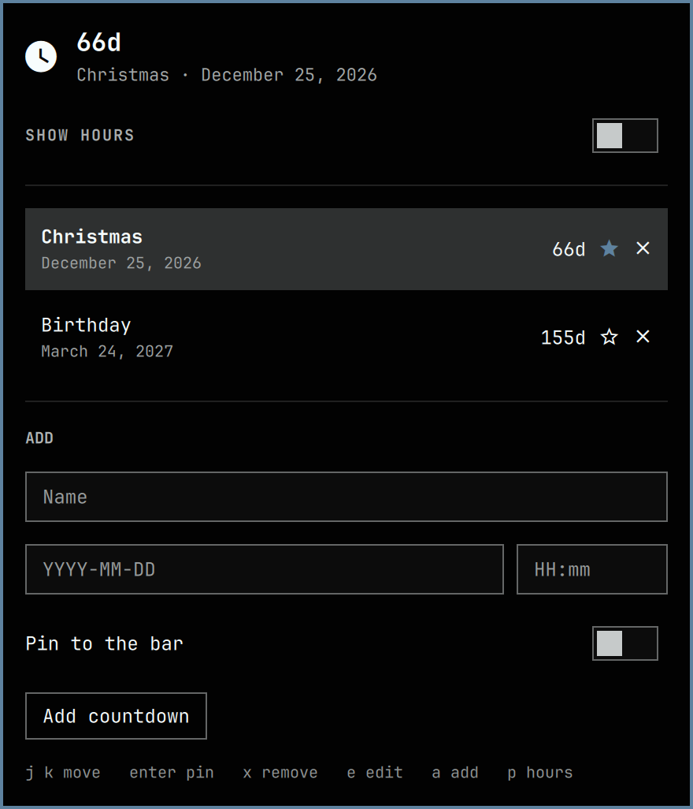

# Omadown

Omadown is an [Omarchy](https://omarchy.org/) bar plugin. It puts a clock icon on the bar with the days left until one countdown, and adds the hours when you ask for them. Click the icon for every countdown you have configured, nearest event first and furthest last.

The countdown marked as the default is the one on the bar. If none is marked, the bar shows the nearest event instead.



This is a `bar-widget`. The details panel is loaded by `BarWidget.qml`. The manifest does not declare a second plugin kind, and the plugin does not start a second Quickshell process.

## Install

A plugin is a git repository with `manifest.json` at its root. Omarchy clones it into `~/.config/omarchy/plugins/com.tbye.omadown/` and turns updates into a fast-forward of that checkout.

```bash
omarchy plugin add https://github.com/tbye/omadown.git --enable
```

`--enable` asks which bar section to use. The manifest asks for the right side. To place it yourself later:

```bash
omarchy plugin enable com.tbye.omadown --section right
omarchy bar move com.tbye.omadown --section center
```

Add refuses to run without a terminal unless you pass `--yes`. Plugins run unsandboxed inside `omarchy-shell`. Read the code before you enable it.

## Remove

```bash
omarchy plugin remove com.tbye.omadown
```

That drops the checkout and the bar slot. The `shell.json` entry goes with the slot, so copy your dates out first if you want them. Removal does not touch any other plugin or any file outside that entry.

## License and dependencies

MIT. See [LICENSE](LICENSE). There are no external dependencies, downloads, or install scripts. The only write is the plugin's own bar entry in `~/.config/omarchy/shell.json`, and that happens when you add, pin, edit, or remove a countdown.

## Upgrade

Countdowns live on the `com.tbye.omadown` entry in `~/.config/omarchy/shell.json`, not in the plugin checkout. An update replaces the QML and leaves your dates where they are.

```bash
omarchy plugin update com.tbye.omadown
```

That fetches `origin`, shows the diff, and fast-forwards. `omarchy plugin update` does every git-managed plugin. Pass `--yes` to skip the prompt.

The installed copy fast-forwards only. A local edit inside `~/.config/omarchy/plugins/com.tbye.omadown/` blocks the update. Change this repository, commit, and update again.

## Use

Left click opens the list. Right click toggles hours on the bar. Middle click pins the next countdown, wrapping from nearest toward furthest.

In the popup:

- The rows run from the nearest event to the furthest. A past date sits where its distance puts it, and reads as time ago.
- Click a row, its star, or press Enter to pin it to the bar. Do that again to unpin. The bar then falls back to whichever event is nearest.
- Add a name and a `YYYY-MM-DD` date. `HH:mm` is optional and makes the countdown land on that minute.
- Press `e` to edit the selected row, `x` to remove it, `a` to jump to the form, and `p` to toggle hours.

With hours off, the bar counts calendar days (`12d`, or `Today` on the day). With hours on, it counts the exact wait (`12d 4h`, `4h`, `40m`). A date with no time arrives at midnight at the start of that day, and the day itself keeps counting down until midnight ends it.

Open and close the same popup from the shell:

```bash
omarchy-shell shell summon com.tbye.omadown '{}'
omarchy-shell shell hide com.tbye.omadown
omarchy-shell shell toggle com.tbye.omadown '{}'
```

Escape closes it.

## Data

The shell stores the list inline on the bar entry:

```json
{
  "id": "com.tbye.omadown",
  "showHours": true,
  "defaultId": "trip",
  "events": [
    { "id": "trip", "name": "Trip", "date": "2026-11-01", "time": "09:30" }
  ]
}
```

`defaultId` is the countdown pinned to the bar. Leave it empty and the nearest event is shown. `time` may be `""`. Editing `~/.config/omarchy/shell.json` by hand is picked up when the file saves.
